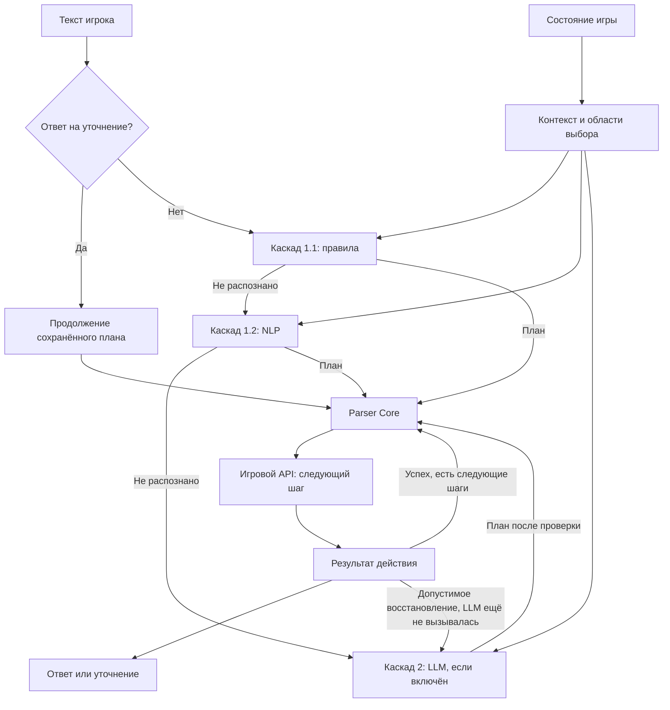

# Парсер: от текста игрока к действиям движка

Этот документ описывает текущее устройство парсера Scanline Engine. Общее объяснение его роли находится в [GDD.md](GDD.md#парсер---посредник). Здесь разобраны понятия, путь команды, форматы данных и правила исполнения. Возможное развитие перечислено отдельно в конце.

## Основные понятия

**Парсер** принимает текст игрока, определяет действие и его цели, составляет план для движка и сообщает результат. **Каскад** — один из способов распознавания текста: правила, локальный классификатор или языковая модель. **Parser Core** — общая часть парсера, которая проверяет и исполняет планы, разрешает неоднозначности и сохраняет незавершённые команды.

**Контекст** (`context`) — снимок ситуации для обработки команды: сцена, предметы, персонажи, их состояния и известные события. **Область выбора** (`scope`) — набор объектов, среди которых можно искать аргументы определённого действия. Знать о предмете, видеть его и иметь возможность взять — разные условия.

**Структурированный план** — упорядоченный список инструкций. Например, «взять ключ» становится шагом `takeTarget` с аргументом `target`. **DSL** (предметно-ориентированный язык) — ограниченный набор таких инструкций и правил их записи. Это не произвольный программный код. Шаг парсера имеет тип `ParserToolAction`, а пакет результата каскада — `ParserCascadeEnvelope` (далее — пакет каскада).

**API** — программный интерфейс движка: операции вроде `takeEntity(...)`. Шаг DSL и вызов API связаны, но не равнозначны: перед вызовом может понадобиться найти объект по названию, запросить уточнение или развернуть авторскую команду в несколько шагов. Некоторые инструкции только показывают текст или сохраняют заметку.

**Результат действия** (`outcome`) — ответ движка: успешно ли действие, что изменилось и какое сообщение можно показать. План описывает намерение; результаты и состояние мира подтверждают выполнение.

В последующих разделах также используются термины:

| Термин | Значение |
| --- | --- |
| `Actor` | Персонаж движка: герой игрока или другой персонаж. |
| NPC | Неигровой персонаж. Его действия может выбирать система Puppet Master. |
| `Inventory` | Компонент хранения предметов у персонажа или объекта; не только экранный рюкзак игрока. |
| `Surface` | Компонент размещения предметов на поверхности с координатами размещения. |
| `protected` | Признак Inventory, ограничивающий чужой доступ к содержимому. Передать владельцу новый предмет всё ещё можно. |
| `Switch` | Компонент с состоянием открытия/закрытия и правилами доступа, в том числе ключом. |
| `Subscene` | Крупный план части сцены для игрока. Сам по себе не является отдельной физической комнатой. |
| Текстовый ассет (TA) | Авторские данные: названия, описания, синонимы и другие текстовые поля. |
| Авторская команда | Действие, которое автор игры явно описал в ассете команды. |
| Семантические правила | Игровой смысл операции: что видно персонажу, что ему доступно и что реально изменится. |

## Путь команды

1. Консоль обрабатывает служебные команды `#...` и сокращения до игрового парсера.
2. `Parser.parse(...)` ставит ввод в очередь. Команды одного экземпляра обрабатываются последовательно, чтобы асинхронное распознавание не смешивало контексты. Реплика с `-` при отсутствии ожидающего уточнения передаётся в `sayAsPlayer(...)` отдельно от каскадов.
3. Парсер проверяет, является ли ввод ответом на предыдущий вопрос. `ParserWorldModelBuilder` собирает контекст и области выбора из состояния игры; ввод передаётся как сопутствующие данные, а не инструкция изменить мир.
4. Каскады по очереди пробуют распознать новую команду. Успешный каскад возвращает план в общем формате; нераспознанный ввод передаётся дальше.
5. Core проверяет пакет, разворачивает авторские команды и выполняет шаги по порядку. Текстовые ссылки разрешаются на стороне парсера, движок получает найденные объекты.
6. После шага с эффектами модель мира обновляется для следующих шагов. При первом статусе, отличном от `ok`, план останавливается.
7. Парсер показывает результат, сохраняет уточнение или при предусмотренных условиях обращается к языковой модели.



Технические имена стадий исторические: `regex-v1`, `nlp-v2`, `llm-v3`. Это источники пакета, а не три независимых парсера. Продолжение уточнения использует `pending-resolution`.

### Многошаговый план и повторное планирование

Одна команда может привести к нескольким действиям. Например, «возьми ID из ящика стола» может быть представлена планом: открыть ящик → найти предмет в обновлённом содержимом → проверить возможность взятия и взять. Если открытие не удалось, дальнейшие шаги не исполняются. Если предмет не найден или недоступен, шаг взятия вернёт отказ. Такой план не требует нового обращения к модели после каждого действия: проверки и обновление данных выполняет Core вместе с движком.

Это возможность исполнителя, а не обещание, что любая формулировка автоматически породит именно такой план: его должен построить каскад или авторская команда. Ограничение на число вызовов LLM не ограничивает число шагов уже принятого плана.

Другая схема — выполнить часть действий, передать их результаты модели и попросить её придумать продолжение, затем повторять это до достижения цели. Такого неограниченного цикла перепланирования в текущем парсере нет.

## Каскады распознавания

### Каскад 1.1: правила и авторские команды

Быстрый детерминированный разбор находится в `Parser.ts`. Он распознаёт стандартные команды, выделяет аргументы и пространственные предлоги, сопоставляет авторские команды через `parserCommands.ts` и создаёт пакет для Core.

Примеры: `LOOK`, `EXAMINE BOOMBOX`, `LOOK UNDER TABLE`, `TAKE KEY`, `GIVE KEY TO LINDA`, `PUT KEY IN BOX`, `OPEN DOOR`, `INV`, `GO TO OFFICE`. Групповые формы `TAKE ALL CASSETTES` и `PUT BLUE AND RED PILLS IN BOX` также разбираются здесь.

Предлоги `in`, `on`, `under`, `behind`, `with`, `to` помогают назначать роли аргументам. Это не самостоятельные действия. Отношения `in/on/under/behind` уже исполняются на реальных пространственных данных; `near` распознаётся, но не имеет реализованной операции хранения или осмотра отношения.

### Каскад 1.2: локальный NLP

`NlpCascade` запускается, если правила не распознали ввод. Использует NLP.js, обучающий набор и общий словарь нормализации. Определяет намерение (`intent`), оценку уверенности и фразы аргументов, затем возвращает тот же пакет с планом, что и каскад правил.

Этот слой помогает с формулировками вроде `pick up the key` или `what do i have?`. Он не определяет допустимость действия и не сочиняет ответы. Сложное сопоставление целей и уточнения остаются в Core.

### Каскад 2: языковая модель

`LlmCascade` включается через `#LLM-ON`. Модель может сопоставить нестандартную формулировку с доступными действиями, предложить уточнение или написать ответ в роли ведущего игры. Возвращённый JSON проверяется и преобразуется в обычный пакет каскада для того же Core.

Обращение к модели возможно:

- когда нижние каскады не распознали команду;
- после результата `escalate`, некоторых ошибок поиска цели и определённых восстанавливаемых отказов: условия заданы в `resultShouldRetryWithLlm(...)`;
- в режиме `#C1-OFF`, который передаёт модели даже распознанную нижними каскадами команду.

На один обычный цикл `parseExclusive(...)` допускается не более одной попытки LLM: либо до выполнения, либо для восстановления после нижнего каскада. Уже предложенный LLM план не запускает новый LLM-цикл по собственному результату. Ответ на сохранённое уточнение также не запускает обычный повторный проход каскадов. Сетевые повторы внутри провайдера — отдельный механизм.

Авторский `takeFailure` с `recoverable: false` завершает отказ без обычного восстановления через LLM. Отсутствие `details` у объекта, напротив, может дать `escalate` и повод сформулировать описание через модель.

### Провайдеры и контекст LLM

Провайдер выбирается фабрикой `createLlmProvider(...)` через `VITE_LLM_PROVIDER`:

| Значение | Реализация | Настройки по умолчанию |
| --- | --- | --- |
| `anthropic` или пустое | `AnthropicProvider` | `claude-haiku-4-5-20251001`, адрес `/api/llm`. |
| `ollama` | `OllamaProvider` | `qwen2.5:3b`, адрес `http://localhost:11434/v1/chat/completions`. |

Это значения текущего кода, а не требование использовать именно эти модели. `ILlmProvider` отделяет парсер от формата сервиса. В веб-режиме Anthropic обслуживается прокси Vite с серверным `ANTHROPIC_API_KEY`. В Tauri `fetchLlm(...)` использует нативный `invoke_llm`; ответ через IPC буферизуется. Ошибки, тайм-ауты, допустимые сетевые повторы и приостановка запросов после серии сбоев обрабатываются слоем провайдера.

Промпт разделён на относительно постоянную часть сцены и динамическую часть команды. Первая содержит инструкции и текстовые данные сцены; вторая — ввод, последние команды, заметки, факты мира, пространственные связи, уточнение, выбранный предмет и предыдущую попытку. Кеширование Anthropic — деталь провайдера. Подготовка постоянной части не создаёт серверный кеш: это происходит при реальном запросе.

Модель может получать служебные сведения о скрытых объектах, но они не становятся знаниями героя. `LlmCascade` ограничивает раскрываемые данные и допустимые действия. Доступность определяет движок, а не описание предмета или догадка модели.

## Контекст и области выбора

`ParserWorldModelBuilder.build(rawInput, pendingState)` возвращает `{ context, scope }`. Он собирает картину мира, но не выбирает намерение и цель команды.

### Контекст

В `ParserContext` входят:

- `rawInput`, `normalizedInput`, сведения об ожидающем уточнении;
- текущая сцена, её текст, активный крупный план и `recentTurns`;
- `entities` — объекты текущего текстового представления сцены;
- `knownEntities` — дополнительные сведения о скрытых/непредъявленных объектах для старшего каскада и диагностики; не список доступных целей героя;
- `inventory` и `focusedTarget` — переносимые предметы и предмет, открытый в окне осмотра инвентаря;
- названия, синонимы, описания, состояния, доступность, содержимое и положение объектов;
- выходы: целевая сцена, вход, режимы `portal`/`collider`;
- `worldFacts` — факты о переноске и расположении, включая авторские смысловые пояснения;
- `spatialNodes`, `spatialRelations`, `actionScope` — пространственная проекция и идентификаторы объектов в областях действия;
- Parser Notes — приватные заметки ведущего, описанные ниже.

Пустые необязательные данные могут опускаться. Точная схема — `parserTypes.ts`; контекст не является сериализованной копией сцены.

`scene.recentTurns` содержит до 8 последних пар «команда → ответ» текущего визита. Ответ сокращается до 340 символов. История не записывается в авторский JSON сцены и очищается при новом визите после ухода.

### Области выбора

| Поле `ParserScope` | Для чего нужно |
| --- | --- |
| `visible` | Объекты текущего текстового представления героя. |
| `held` | Предметы в инвентаре игрока с доступным названием. |
| `takable` | Текущие доступные источники для взятия. |
| `putSource` | Сценовые источники для помещения в другое место; переносимые предметы учитываются через `held`. |
| `reachable` | Объекты, доступные для непосредственного взаимодействия. |
| `examinable` | Объекты, допустимые для подробного осмотра сейчас. |
| `subscene` | Объекты активного крупного плана. |
| `worldKnown`, `hiddenKnown` | Дополнительные знания для старшего каскада и диагностики, не обычные варианты выбора. |

Обычные команды не должны превращать `worldKnown` или `hiddenKnown` в разрешение взять скрытый предмет. Видимая далёкая цель может участвовать в объяснении отказа или автоматическом подходе. Варианты уточнения выбираются по роли аргумента: предмет-источник, получатель, контейнер и т. п.

Для предмета на `Surface` используются координаты из `Surface.items`, а не потенциально устаревшие `entity.x/y`. Видимость, преграды и пространственные связи берутся из общей модели сцены, а не вычисляются каждым каскадом заново.

## Формат плана и результаты

### Единый пакет всех каскадов

У `ParserCascadeEnvelope` два варианта `output`: `plan` или `handoff_up`. Отдельных вариантов `intent`, `final_response`, `clarification` на этом уровне нет. Намерение отражается в плане и отладочных данных.

Пример пакета для `TAKE KEY`:

```json
{
  "stage": "regex-v1",
  "output": {
    "kind": "plan",
    "actions": [{ "type": "takeTarget", "target": "key" }]
  },
  "debug": {
    "rawInput": "take key",
    "normalizedInput": "TAKE KEY",
    "verb": "TAKE",
    "noun": "key"
  }
}
```

`target: "key"` ещё текстовая ссылка. Core ищет объект и только затем вызывает `takeEntity(...)` с самим объектом. Встроенные команды используют названия и синонимы; служебные действия и авторские спецификации могут явно ссылаться на id.

Пример многошагового `output` для близкого незапертого ящика с подходящим предметом:

```json
{
  "kind": "plan",
  "actions": [
    { "type": "openTarget", "target": "Desk drawer" },
    { "type": "takeTarget", "target": "ID card", "anchor": "Desk drawer", "relation": "in" }
  ]
}
```

После открытия Core обновляет модель мира. Следующий шаг ищет ID относительно ящика и проверяет условия взятия на актуальных данных. Проверка содержимого здесь входит в обработку `takeTarget`, а не обязательно записывается отдельной инструкцией. План останавливается при отказе любого шага.

Если каскад не распознал ввод, он возвращает пакет с `output.kind: handoff_up`, полями `reason`, `rawInput`, `verb`, `noun` и обычными `stage`/`debug`. Это передача обработки, не фиктивное игровое действие. Если доступного старшего каскада нет или он не помог, команда завершается сообщением о непонимании.

### Набор инструкций

Форма аргументов задаётся `ParserToolAction` в `parserTypes.ts` и проверками `runtimeSchemas.ts`:

| Назначение | Типы шагов |
| --- | --- |
| Осмотр | `lookScene`, `lookTarget`, `lookRelationTarget`, `examineTarget`, `examineRelationTarget` |
| Предметы | `takeTarget`, `giveTarget`, `putTarget`, `showInventory` |
| Открытие и перемещение | `openTarget`, `closeTarget`, `goToTarget`, `quitCurrentView` |
| Аргументы и авторские команды | `runCustomCommand`, `resolveArgumentEntity`, `ensureHeldEntity`, `actorUseOn` |
| Служебные операции | `goToSceneById`, `removeInventoryEntity`, `requireEntityAvailable`, `requireAnyEntityAvailable` |
| Изменения, предусмотренные автором | `setEntityState`, `setGroupDisabled`, `runScript`, `stopScript` |
| Ответ и продолжение | `showText`, `parserFailure`, `llmClarification` |
| Заметки ведущего | `setSceneParserNote`, `setEntityParserNote` |

Наличие шага в типе Core не означает, что LLM разрешено выдать его напрямую. У `LlmCascade` есть `ALLOWED_ACTION_TYPES` и проверка полей. Неизвестные и некорректные действия отфильтровываются и попадают в диагностику. Пустой или невалидный ответ не становится исполняемым планом.

План линейный: без произвольного кода, циклов и `if/else`. Промежуточный результат поиска можно сохранить в `ParserPlanState` через `saveAs` и использовать как `ref` в следующих шагах. Это состояние исполнения, не память персонажа.

### Ответ модели и пакет Core

Сырой ответ LLM и внутренний пакет парсера — разные форматы:

| `kind` ответа модели | Преобразование в `LlmCascade` |
| --- | --- |
| `plan` с `actions` | Проверка действий и обычный пакет `plan`. |
| `final_response` с `message` | Шаг `showText` обычного плана. |
| `clarification` с `question` и `pendingAction` | Шаг `llmClarification` для сохранения продолжения. Если цель уже однозначна, действие может исполниться сразу. |
| `fallback` | Отсутствие LLM-пакета; обработка завершается обычным путём. |

Уточнение без корректного `pendingAction` не принимается как простая текстовая реплика: иначе следующий ответ игрока не к чему привязать. JSON может быть обёрнут в Markdown-блок; извлечение и разбор выполняют `llmJson.ts` и `LlmCascade`.

Для запросов на чтение/осмотр нормализатор убирает добавленный моделью `takeTarget`: осмотр не должен незаметно присваивать предмет. Рассказ об обнаружении можно привязать к `examineTarget.narration.requiresDiscoveredEntityIds`; он допустим только после фактического обнаружения указанных объектов.

### Результат действия и результат плана

`GameActionOutcome` содержит:

| Поле | Смысл |
| --- | --- |
| `status` | `ok`, `failed`, `needs_clarification`, `escalate`. |
| `code` | Машинный код, например `item_taken`. |
| `message` | Необязательный текст игроку. |
| `data` | Дополнительные структурированные сведения. |
| `effects` | Список эффектов для последующей обработки. |
| `recoverable` | Возможность восстановления после отказа; само по себе не запускает LLM. |

Core возвращает `ParserResult`: `type: outcomes` с собранными результатами или `type: handoff` с причиной передачи обработки. `handled: true` означает обработку плана, а не успех всех шагов.

```json
{
  "type": "outcomes",
  "handled": true,
  "outcomes": [
    {
      "status": "ok",
      "code": "item_taken",
      "message": "You picked up the key.",
      "data": { "entityId": "key_1" },
      "effects": ["moved_to_inventory"]
    }
  ],
  "actionsExecuted": ["take"]
}
```

План не является общей транзакцией: ошибка не отменяет уже успешные шаги. Подход также асинхронен: `player_approaching_for_action` означает начало движения и планирование действия после прибытия, а не уже выполненное взятие.

## Поиск целей и уточнения

Парсер сопоставляет фразу с `title` и `synonyms`, поддерживает частичные совпадения и использует область конкретного действия. Технические id не должны попадать в обычные вопросы. Исключения вроде адресации Exit по id обслуживаются отдельным путём переходов, а не общим сопоставлением всех объектов по id.

Если аргумент отсутствует, парсер спрашивает, например `Take what?`. Если подходят несколько различимых объектов, показывает нумерованные варианты:

```text
Which item do you mean: 1: Compact cassette, 2: Cassette 'Music'?
```

`pendingState` сохраняет намерение, исходный ввод, вопрос, пакет продолжения и варианты с `index`, `label`, `entityId`, `scope`. Номера действуют только для текущего вопроса.

Ответом может быть номер, название, синоним или однозначный фрагмент. Для предметов-источников доступны также `1, 2`, `all`, `both` при двух вариантах и списки названий. Множественный выбор получателей или контейнеров не поддерживается.

Частично неверный или неоднозначный ответ ничего не исполняет: вопрос сохраняется и повторяется. Новая распознаваемая команда может отменить уточнение. Если кандидаты имеют одинаковое название, применяется выбор: сначала предмет в инвентаре, затем порядок инвентаря или ближайший сценовый объект.

Инвентарь участвует в `LOOK` и `EXAMINE`, а также как источник `GIVE` и `PUT`. `GO TO` не использует переносимые предметы как сценовые цели. `TAKE` обычно ищет предметы сцены; извлечение из контейнера использует отдельную область относительно контейнера.

`LOOK floor` и `EXAMINE floor` сначала проверяют текст пола текущего Walkbox под героем, затем настоящие объекты с названием/синонимом Floor, затем стандартный ответ. Для краткого осмотра используется `description`, для подробного — `details`.

### Групповые TAKE и PUT

Поддерживаются `all <query>`, `both <query>`, списки через запятую/`and` и сокращённая форма `blue and red pills`. Команда разворачивается в последовательность обычных `takeTarget` или `putTarget`.

- `both` требует ровно два совпадения.
- Неверный элемент отклоняет список до выполнения; дубликаты удаляются с сохранением порядка.
- Для `PUT` сначала проверяется получатель; предметы, уже находящиеся в выбранном месте, исключаются.
- Упрощённое множественное число убирает конечную `s` у слов длиннее трёх символов. Сложная английская морфология не поддерживается.
- Автоматического подхода в многошаговом плане нет. Отказ позднего шага не отменяет предыдущие успешные перемещения предметов.

## Технические правила выполнения действий персонажей

### Общий движок для парсера и Puppet Master

Парсер и Puppet Master предлагают действия разными путями, но не должны независимо вычислять игровые правила. `GameSemanticAPI`, `ActorWorldQuery`, `ActorNavigationService`, `ActorCommandExecutor` обслуживают обоих.

| Сравнение | Парсер игрока | Puppet Master |
| --- | --- | --- |
| Основа решения | Текст игрока и контекст героя. | Цели NPC, восприятие и события. |
| План | `ParserCascadeEnvelope.output.actions`, шаги `ParserToolAction`. | `NpcPlan.steps`, шаги `NpcPlanStep`; ответ может содержать планы нескольких NPC. |
| Цели | Обычно названия/синонимы, затем найденные объекты; служебные шаги используют и id. | В основном `targetId`, `itemId`, `commandId` из контекста NPC. |
| Исполнитель | Core в `Parser.ts`. | `ActorPlanExecutor`, продолжения в `NpcPuppetMaster`. |
| Особые шаги | Уточнения, сообщения, Parser Notes. | Реплики, ожидание, память, задачи и переходы. |

Оба плана — ограниченные инструкции, но это разные DSL, не взаимозаменяемые JSON-пакеты. После разрешения целей действия сходятся на общих сервисах. NPC не отправляет план обратно через текстовый парсер.

### Видимость, доступ и расстояние

`ActorWorldQuery` описывает восприятие объекта относительно персонажа: виден ли он, находится ли при персонаже, доступен ли сейчас и возможен ли подход. Сведения о допустимых действиях в контексте должны согласовываться с исполнением; расхождение — ошибка движка.

Общие проверки учитывают скрытость, прозрачность и непрозрачность преград, закрытые контейнеры, ключи, защиту инвентаря и достижимость. Выключенный (`disabled`) объект вне неактивного крупного плана считается отсутствующим для восприятия.

Непосредственную дистанцию проверяет `ComponentSystem.getInteractionDistanceError(...)`. Текущий порог — `2 * interactionWidth`, где `interactionWidth` — ширина персонажа с запасным значением 30; при нулевой ширине коллайдера используется 30, чтобы большой спрайт не давал чрезмерную дальность.

Расстояние до полигона считается по геометрии (`poly`/`vertices`) с учётом визуального положения, до предмета на Surface — по координатам размещения. Проверка учитывает допустимых пространственных предков; Walkbox не может сделать любой предмет на своём полу близким. Опорные точки полигонов и Quad Exit также вычисляются по вершинам, а не только редакторским `x/y`.

`ActorNavigationService` ищет позицию подхода и реальный маршрут. Недостаточно, чтобы точка лежала на проходимом, но несвязанном участке. Статусы: `already_reachable`, `route_available`, `unreachable`.

### Подход и переходы

Для одиночных команд героя `EXAMINE`, `TAKE`, `OPEN`, `CLOSE` видимая далёкая цель может вызвать подход и выполнение после прибытия. При невозможном маршруте сохраняется отказ по расстоянию. Открытый крупный план и многошаговые планы отключают такой подход.

`GO TO` ищет сценовую цель и использует общую навигацию. Exit можно выбрать по id/названию объекта или id/name/title целевой сцены. Доступный Exit активируется сразу, далёкий — после подхода. `QUIT [THROUGH ...]` использует тот же путь выхода. При открытом крупном плане `GO TO` заблокирован и не может переключить сцену за ним: сначала нужно закрыть текущий вид.

Для явного NPC `TAKE` добавляется `MOVE_TO`, если предмет известен, ещё недоступен непосредственно, но имеет `approach: route_available`. NPC-контекст описывает положение, доступные действия и подход смысловыми связями; модель не должна самостоятельно выбирать координаты объектов.

Для одной цели `MOVE_TO` допускается не более трёх последовательных `route_unreachable`. Промежуточный вызов получает оставшееся число попыток, третий провал становится `repeated_without_progress`. Повторять тот же путь без новых условий нельзя.

### Осмотр и обнаружение

`LOOK` использует краткое `description`, `EXAMINE` — `details` и правила близкого взаимодействия. Переносимые предметы и доступные объекты активного крупного плана также можно осматривать. Без `details` движок может вернуть `escalate`, а не выдумывать подробности в детерминированном слое.

Осмотр дополняется сводкой видимого содержимого по `in/on/under/behind`. Безымянные технические узлы схлопываются, отношение определяется относительно выбранного именованного объекта. Книга на другой книге внутри шкафа входит в `LOOK IN CABINET`; относительно нижней книги она находится `on`.

Парсер использует `SceneTextLayer`, а не собственный рекурсивный обход raw `.spatial`. Активация Subscene раскрывает непосредственный уровень вложенности, а не автоматически всё поддерево.

Обнаружение подчиняется режиму `hidden`. `parser.relation_contents` описывает обычное видимое содержимое, `parser.relation_discovered_contents` — первое фактическое обнаружение скрытого. После обнаружения используется обычная форма. Успешный TAKE окончательно сбрасывает `hidden` у экземпляра: перенос и оставление в другой сцене не должны снова скрыть найденную вещь.

### Перенос предметов и GIVE

TAKE и PUT проверяют источник, получателя, расстояние, владельца и доступ к Inventory относительно действующего персонажа. Интерфейс и анимация героя — дополнительные визуальные эффекты, не отдельные правила владения.

`GIVE <item> TO <Actor>` переносит предмет в основной Inventory получателя (`relation: in`). Источник — предмет при дающем или доступный для взятия предмет рядом. Проверяются доступ к получателю, условия взятия источника и свободное подходящее место. Защита Inventory скрывает чужое содержимое, но не запрещает передачу туда.

При обычном отказе предмет не передаётся. Успех возвращает `code: item_given`, `data.actionType: GIVE`, id дающего/получателя/предмета и `data.worldChanged: true`; событие попадает в журнал сцены и восприятие. Предложение, согласие, реплика или ещё не выполненный шаг GIVE не подтверждают владение. Его подтверждают результат операции, обновлённый инвентарь или история действий.

Успех вызывает `wakeNpc(..., 'item_received')`: включённый NPC получает контекст после передачи. Отказ не вызывает такое пробуждение; неудача NPC-действия возвращается в обработку `ACTION_FAILED`.

### Крупный план и NPC

Subscene — режим камеры и интерфейса героя. Именованные объекты внутри неактивного вида остаются частью мира, если доступны по общим правилам. Герой может открыть нужный вид, меняя `scene.activeSubscene`. NPC взаимодействует через внешний объект-привязку, не переключая камеру и не включая скрытые визуальные элементы.

Открытие, закрытие и перенос меняют реальные состояния. При последующем открытии вида игроком визуальная часть синхронизируется с ними.

### Память и наблюдение NPC

`knownEntities` NPC — накопленный журнал замеченных сущностей: id, тип, `lastSeenSceneId`, необязательный `lastSeenLocation`. Он отличается от текущего `visibleItemIds` и текстовой памяти. События TAKE/PUT обновляют запомненное положение: относительно объекта (`in/on/under/behind`) или в инвентаре персонажа.

`currentSceneId` в динамическом контексте — достоверное текущее положение. Старые заметки, `lastSeenSceneId` и переходы не должны его переопределять. `actionHistory` хранит 20 последних результатов NPC между сценами: исходную сцену, время, возраст `ageMs`, результат и краткий факт. Защита от повторов и интервалы ожидания учитываются в рамках сцены.

`MEMORY` содержит подтверждённые факты; `MEMORY_ADD`/`MEMORY_REMOVE` поддерживают их актуальность. `CURRENT OBJECTIVES` — сохраняемое между сценами дерево задач со стабильными id, текстом и подзадачами. Новое обязательство отражается через `OBJECTIVE_ADD` до зависимых действий, если подходящей задачи ещё нет. `OBJECTIVE_UPDATE` меняет план, `OBJECTIVE_REMOVE` убирает неактуальную ветвь.

В текущем пути Puppet Master `OBJECTIVE_MARK_COMPLETED` может отметить конечную задачу по доступным подтверждениям, без обязательного совпадения с одним конкретным событием. Проверка отклоняет структурные противоречия: например, завершение родителя с активными подзадачами. Это состояние планирования, не выполнение физической задачи. Завершённая задача показывается один следующий ход как `[JUST COMPLETED]`, затем убирается. После подтверждённого перехода временная заметка `Arrived in ...` показывается как `[JUST ARRIVED]` и позднее убирается.

Наблюдатели выбираются по общей видимости и `perceptionRadius` (по умолчанию 600). Значимые события записываются в SceneLog. Обычное событие действия не вызывает немедленный LLM-вызов наблюдателя: NPC получает его при следующем пробуждении, герой-наблюдатель видит отдельную строку консоли. Чужой защищённый инвентарь при этом не раскрывается.

### Продолжения и защита от повторов NPC

Puppet Master объединяет близкие по времени события в пакет сцены, ограничивает частоту запросов и отслеживает повторы без изменения мира. `action_completed` может передавать `worldChanged`, `discoveredEntityIds`, `repeatCount`. Цепочка без прогресса останавливается до новых условий/события; повторяющиеся циклы также вызывают временную приостановку NPC.

Асинхронный шаг оставляет продолжение. В `awaiting_barrier` исполнитель ждёт окончания движения, ожидания или другого действия; обычное новое событие не должно подменять принятый план. События откладываются и возвращаются после разрешения барьера. Явная политика `interruptOn` может прервать продолжение. Его ключ использует фактическую сцену персонажа, не глобальную сцену игрока.

Если проверка предметов отклоняет физическое продолжение NPC-плана, допустимые начальные реплики и операции памяти исполняются один раз и не повторяются при исправляющей попытке. Память всего отклонённого плана не сохраняется как будто он завершился.

### Особые авторские действия и USE

Базовый ассет `use_on` отвечает `How to use?`: это не универсальное применение любого предмета. Реальные применения описываются отдельными командами в `public/text/system/commands/*.json`. У Puppet Master нет общего шага USE; используется COMMAND с объявленной в контексте командой. Внутренний `actorUseOn` не отменяет это правило.

Аргументы, `separatorsBefore`, проверки, ссылки между шагами и операции с состояниями/скриптами описаны в [Commands.md](Commands.md). Общие авторские операции обслуживает `ActorCommandExecutor`.

## Текстовые данные и Parser Notes

### Файлы и локализация

| Файл | Содержимое |
| --- | --- |
| `public/text/system/parser.json` | Ответы и вопросы парсера. |
| `public/text/system/parser-lexicon.json` | Глаголы, варианты команд, артикли, префиксы, предлоги, нормализация. |
| `public/text/system/parser-training.json` | Примеры для NLP.js. |
| `public/text/system/parser-llm-system.md` | Инструкции языковой модели. |
| `public/text/system/commands/*.json` | Авторские команды. |
| `public/text/objects/*.json` | Названия, описания и смысловые метаданные объектов. |

Оба уровня первого каскада используют общий языковой набор. Идентификаторы действий, API и служебные команды остаются в коде. Наличие ассетов не гарантирует готовность к любому языку: нужны словарь, обучающие примеры и проверка грамматики.

### Поля объектов

- `title`, `synonyms` — название и альтернативные обращения.
- `description` — краткое описание LOOK, `details` — подробности EXAMINE.
- `lore` — скрытый от прямого вывода контекст LLM: история, характер, обстановка.
- `takeFailure` — авторский отказ для неберущегося объекта; непустой текст делает отказ окончательным для обычного LLM-восстановления.
- `semanticTags`, `relationFacts` — смысловые факты; сами не создают механику или команды.

Текстовое поле можно записать строкой или массивом строк. Массив соединяется через `\n`; пустой элемент даёт пустую строку.

```json
{
  "title": "Compact cassette",
  "description": "An audio cassette.",
  "details": ["A handwritten label.", "", "The tape seems intact."],
  "lore": "",
  "takeFailure": "",
  "synonyms": ["tape", "cassette"],
  "semanticTags": ["audio_media"],
  "relationFacts": []
}
```

`relationFacts` задаётся на содержащем объекте:

```json
{
  "title": "Boombox",
  "relationFacts": [
    {
      "relation": "in",
      "childTags": ["media", "audio_media"],
      "fact": "{self} already has {child} loaded."
    }
  ]
}
```

Когда внутри находится предмет с подходящим тегом, `worldFacts` получает `Boombox already has Compact cassette loaded.`. Подстановки: `{self}` — название содержащего объекта, `{child}` — вложенного, `{relation}` — отношение. Это пояснение модели, не автоматическое включение магнитофона. Обычные факты о переноске и расположении добавляет сам движок.

### Заметки ведущего

Parser Notes — приватные заметки LLM о небольших придуманных подробностях, которые должны оставаться согласованными между командами. Они не заменяют координаты, инвентарь и реальные состояния.

`setSceneParserNote` заменяет заметку сцены, `setEntityParserNote` — объекта. Пустая строка очищает запись; непустая ограничивается 600 символами. Прямая запись скрытому объекту из `knownEntities` не разрешена, пока он не видим или не находится при герое. Эти шаги не выводят текст сами по себе.

LLM-план с заметками обязан содержать `showText` и допускает только заметки и текст: обычные действия мира удаляются нормализатором. Это отделяет повествовательное дополнение от физической операции.

Заметки живут в состоянии прохождения, не в авторском JSON сцены; включаются в сохранение игры. Запись сбрасывает `parserNoteNeedsCheck`. Обычная операция над объектом/содержимым помечает существующую заметку для проверки, не стирая её. Модель должна сверить её с актуальными фактами и при необходимости заменить или очистить.

## Отладка

| Команды | Назначение |
| --- | --- |
| `#PEEK-ON/OFF` | Контекст, области выбора, пакет, решение Core, результаты и диагностика NLP/LLM. |
| `#PEEKLLM-ON/OFF` | Полные запросы и сырые ответы/ошибки LLM в открытой консоли, включая Puppet Master. |
| `#PEEKPN-ON/OFF` | Только контекст и изменения Parser Notes. |
| `#STAGE1-ON/OFF` | Правила, каскад 1.1. |
| `#STAGE2-ON/OFF` | NLP, каскад 1.2. Историческое имя, не переключатель LLM. |
| `#LLM-ON/OFF` | Языковая модель, каскад 2. |
| `#C1-OFF` / `#C1-ON` | Передавать результат первого каскада в LLM / исполнять обычным путём. Эксперимент требует включённой LLM. |

При ошибке сначала сопоставьте `CONTEXT`, `SCOPE`, `ENVELOPE`, `CORE`, `RESULT`: что было известно, кого можно было выбрать, какие шаги предложены и какой отказ вернул движок. LLM-диагностика содержит запрос, сырой ответ, принятые/отфильтрованные действия, провайдер, длительность, токены и причину ошибки.

`#PEEKPN` показывает полный текст заметки и операции `context`, `created`, `updated`, `cleared`, `needsCheck`. В веб-сборке используйте [debugAPI.md](debugAPI.md): `api.scenes.load(...)`, `api.console.sendCommand(...)`, `api.console.getMessages(...)`. В Tauri этот отладочный API отсутствует. Служебные команды консоли обрабатываются до игрового парсера.

## Карта кода

| Файл | Ответственность |
| --- | --- |
| `src/core/Console.ts`, `src/components/UIOverlay.tsx` | Ввод, предварительная обработка, реплики, переключатели. |
| `src/mechanics/Parser.ts` | Очередь, правила, Core, поиск, уточнения, исполнение, ответы. |
| `src/mechanics/ParserWorldModelBuilder.ts` | Контекст и области выбора. |
| `src/mechanics/parserTypes.ts`, `src/contracts/runtimeSchemas.ts` | Типы и проверки контрактов. |
| `src/mechanics/NlpCascade.ts`, `src/mechanics/parserLanguage.ts` | NLP и общий языковой набор. |
| `src/mechanics/LlmCascade.ts`, `src/mechanics/llm/llmJson.ts` | Промпт, ответ модели, фильтрация, нормализация. |
| `src/mechanics/llm/*.ts`, `src/platform/llmApi.ts`, `vite.config.ts` | Провайдеры, транспорт, прокси, ошибки, повторы. |
| `src/mechanics/parserCommands.ts`, `src/mechanics/ActorCommandExecutor.ts` | Авторские команды и общее исполнение. |
| `src/core/Game.ts`, `src/core/IGame.ts`, `src/core/GameActionTypes.ts` | Входы API и результаты. |
| `src/systems/GameSemanticAPI.ts` | Общие LOOK/EXAMINE/OPEN/CLOSE/TAKE/GIVE/PUT. |
| `src/systems/ActorWorldQuery.ts`, `src/scene/SceneTextLayer.ts` | Восприятие, доступ и текстовая проекция пространства. |
| `src/systems/ActorNavigationService.ts`, `src/systems/ComponentSystem.ts` | Подход, маршрут и дистанция. |
| `src/systems/InventoryManager.ts` | Хранение, владение, размещение. |
| `src/mechanics/NpcPuppetMaster.ts`, `src/mechanics/NpcWorldModelBuilder.ts` | Планирование NPC, контекст, события, продолжения. |
| `src/mechanics/ActorPlanExecutor.ts`, `src/mechanics/npcTypes.ts` | Исполнение и типы NPC-планов. |
| `src/core/TextAssetManager.ts`, `src/scene/Scene.ts` | Ассеты, заметки, история команд сцены. |

Основные вызовы API: `lookScene`, `lookEntity`, `examineEntity`, `openEntity`, `closeEntity`, `takeEntity`, `putEntity`, `showInventory`, `goToEntity`, `goToScene`, `closeFocusedView`. Общие версии с явным персонажем: `lookEntityForActor`, `examineEntityForActor`, `openEntityForActor`, `closeEntityForActor`, `takeEntityForActor`, `giveEntityForActor`, `putEntityForActor`. Полный интерфейс — `IGame.ts`; UI и скрипты могут использовать его без текстового парсера.

## Проверки

Автотесты находятся в текущем репозитории; устройство и фикстуры описаны в [Autotests.md](Autotests.md).

| Контракт | Файлы тестов |
| --- | --- |
| Команды, авторские планы, группы | `tests/parser/commands.test.ts` |
| Остановка плана, передача обработки | `tests/parser/core.test.ts` |
| Поиск и уточнения | `tests/parser/resolution.test.ts` |
| Контекст и скрытые знания | `tests/parser/world-model-context.test.ts` |
| Нормализация и фильтрация LLM | `tests/parser/llm-cascade.test.ts` |
| LLM в парсере, восстановление | `tests/parser/llm-parser.test.ts` |
| Последовательность ввода | `tests/parser/concurrency.test.ts` |
| Реплики и предварительная обработка | `tests/parser/say-command.test.ts`, `tests/parser/preprocessor.test.ts` |
| Провайдеры и ошибки | `tests/mechanics/llm-provider-factory.test.ts`, `tests/parser/ollama-provider.test.ts`, `tests/parser/provider-policy.test.ts` |
| Общие игровые правила | `tests/game/semantic-api.test.ts`, `tests/game/navigation-and-spatial.test.ts` |
| Планы NPC | `tests/npc/puppet-master.test.ts` |
| Парсер вместе с движком | `tests/integration/parser-game.test.ts` |
| Проверки формата | `tests/contracts/runtimeSchemas.test.ts` |

Начните с соответствующего изменению файла. Примеры более широких проверок:

```bash
npx vitest run tests/parser tests/integration/parser-game.test.ts
npx vitest run tests/game tests/npc/puppet-master.test.ts
npm run typecheck
npm test
```

LLM-тесты используют подставной провайдер: проверяют контракты и обработку ответов, не качество живой модели и доступность сервера. Обычная правка текста не требует полного тестового прогона.

## Текущие ограничения и возможное развитие

Уже работают общий пакет каскадов, многошаговые линейные планы, отношения `in/on/under/behind`, открытие/закрытие, передача предметов, авторские команды, сохранённые уточнения, заметки и оба провайдера LLM. Это не планы на будущее.

Отдельными будущими задачами остаются перепланирование по серии результатов, более богатый диалоговый контекст и определение игровой семантики `near`. Универсального «использовать что угодно» нет. Новые провайдеры и механики должны подключаться через существующие интерфейсы и общий игровой API.

Связанные документы: [GDD.md](GDD.md), [Commands.md](Commands.md), [SpatialSys.md](SpatialSys.md), [Autotests.md](Autotests.md), [debugAPI.md](debugAPI.md).
